# Personal PDF Study Assistant (RAG)

Ask questions about a long policy document and get short answers **grounded in the document,
with page citations**, or a plain *"The document does not contain this information."* when it
doesn't say.

The corpus is five prose-heavy chapters (193 pages) of **India's Economic Survey**:
agriculture, services, industry, infrastructure, and environment and climate. The pipeline is
built from scratch with LangChain (LCEL), local `all-MiniLM-L6-v2` embeddings, FAISS, and a hosted
LLM (Gemini Flash, or open models on Groq). It is evaluated on hand-written questions with known
answer pages.

```text
Q: What share of India's workforce is employed in agriculture and allied activities?
A: Agriculture and allied activities account for 46.1 per cent of India's workforce [p. 2].

Q: What is the RBI's current repo rate?
A: The document does not contain this information.
```

---

## The problem

A 193-page report is too long to read for one fact, and a general chatbot answers from its
training data: possibly outdated, never cited, and sometimes invented. This project answers
**only from the document**, and every claim comes with the page it was taken from, so it can
be checked.

## How it works

```mermaid
flowchart LR
    subgraph offline["Built once (offline)"]
        A[Survey PDF] -->|PyPDFLoader| B[193 pages]
        B -->|"cleaning: footnotes, running heads,<br/>chart debris, paragraph &amp; sentence breaks"| C[5 chapter texts<br/>+ page positions]
        C -->|"RecursiveCharacterTextSplitter<br/>1,000 chars, 200 overlap"| D[615 chunks<br/>with page ranges]
        D -->|"all-MiniLM-L6-v2<br/>384-d, normalised"| E[(FAISS<br/>inner-product index)]
    end
    subgraph online["Per question (online)"]
        Q[Question] -->|embed| R{Top-5<br/>retrieval}
        E --> R
        R -->|"format_docs:<br/>[Source n &#124; p. N]"| P[Prompt: answer only<br/>from sources, cite pages]
        Q --> P
        P --> L[LLM<br/>Gemini / Groq]
        L --> S[Answer with page citations<br/>+ source chunks]
    end
```



| Stage | What it does | Key choices |
|---|---|---|
| **Load** | `PyPDFLoader`, one document per page | the corpus is sliced to prose chapters by `download_data.py`, because table-heavy chapters don't survive text extraction |
| **Clean** | removes footnote blocks (found by following the document's own footnote numbering), running heads, chart debris, URLs; rebuilds paragraphs from the Survey's paragraph numbers; puts one sentence per line | 501,710 → 429,976 characters (14.3% removed); 3 blank spacer pages dropped |
| **Join** | joins each chapter into one text, gluing paragraphs that continue across a page break, and records where every page starts | all 94 cross-page paragraphs stay whole; every chunk keeps its exact page range |
| **Chunk** | 1,000 characters, up to 200 overlap, cut at paragraph → sentence → word boundaries | 615 chunks; 1% end mid-sentence |
| **Embed & index** | `all-MiniLM-L6-v2` on the GPU (CPU fallback), normalised vectors, FAISS `IndexFlatIP` | for unit vectors the inner product **is** cosine similarity; the index is saved, reloaded and verified against the chunks |
| **Retrieve** | top-5 chunks with cosine scores | raw scores are used: LangChain's "relevance score" turns an inner product upside down |
| **Generate** | an LCEL chain: `{"context": retriever \| format_docs, "question": RunnablePassthrough()} \| prompt \| llm \| StrOutputParser()`, plus a variant that returns the source chunks | temperature 0; no "thinking"; an exact refusal sentence; exponential backoff with jitter that honours the provider's suggested wait and stops on a daily quota |
| **Check** | every cited page must be among the pages supplied; answers without citations are flagged | citations are read tolerantly (models write `[p. 55]`, `[Source 1 \| p. 55]`, `【p. 55】`) |

## Results (Phase 8)

Evaluated on **20 hand-written questions**: 15 factual (one gold page each) and 5 analytical
(several gold pages each). The questions are specific to this edition of the Survey and are kept
out of the repository.

**Retrieval: is a gold page among the top *k* chunks?** No LLM involved.

| Chunk size | Factual hit@3 / @5 / @10 | Analytical hit@3 / @5 / @10 | Analytical: share of gold pages found @3 / @5 / @10 |
|---|---|---|---|
| 500 | 100 / 100 / 100% | 60 / 60 / 80% | 20 / 25 / 42% |
| **1,000 (used)** | **100 / 100 / 100%** | **60 / 80 / 80%** | **32 / 42 / 58%** |
| 2,000 | 93 / 93 / 100% | 80 / 80 / 80% | 37 / 42 / 53% |

- **Single-fact retrieval is saturated** at 500 and 1,000 characters: the gold page is the very
  first chunk for 13 of 15 questions.
- **2,000-character chunks lose a question.** 70% of them exceed the embedding model's 256-token
  input limit, so most of each chunk is never embedded.
- **Multi-page coverage grows with *k*** (32% → 58%) and is best at 1,000 characters. Questions
  that need several distant pages are the weak point.

**Answers, at 1,000 characters and k = 5:**

| | GPT OSS 120B (Groq) | Qwen 3.8 27B (Groq) |
|---|---|---|
| Factual questions with the key facts correct | 14 / 15 | 14 / 15 |
| Factual answers citing the gold page | 15 / 15 | 15 / 15 |
| Citations backed by the supplied sources | 20 / 20 | 20 / 20 |
| Analytical questions refused | 2 | 1 |
| Output tokens per answer (factual / analytical) | 75 / 199 | 40 / 98 |

The one factual miss was the **same for both models and not their fault**. Cleaning glued
footnote 68 onto a ratio, so the source text reads "10.9:4.1:1**68**", and both models faithfully
reported the corrupted figure. Evaluating against known answers is what exposed it.

## Where it fails (Phase 9)

| Failure | Example | What happened | Why the architecture fails |
|---|---|---|---|
| **Multi-hop** | how soil carbon, grid intermittency and critical minerals shape strategy (pp. 14–15, 168, 171) | refused: none of the 4 pages was retrieved | the question becomes **one** vector averaging several topics, so it is close to no single passage, and broad overview passages win the 5 slots. (A two-fact comparison that *names* both facts works: each fact wins its own slot.) |
| **Aggregate** | how many missions are mentioned? | "seven", correctly cited, but the true count is at least 25 | a count needs every passage; top-k reads 5 of 615 chunks (<1%), and the LLM counts its sample as if it were the whole document |
| **Tables** | cargo at major ports in FY25 (Table VII.1) | **wrong**: 1,603 Mt (all ports) instead of 854.8, with a genuine citation | text extraction flattens the grid, and cleaning deleted the numeric rows as chart debris; the model then used a look-alike number from nearby prose |
| **Tables** | MSME credit growth, March 2024 (Table VIII.3) | refused, although the right row was retrieved | the header lost its years in cleaning, so the number can't be matched to its column |

The port-cargo case is the most important: fluent, specific, **cited**, and wrong. The citation
check can't catch an answer to a slightly different question; only evaluation against known
answers can.

**Improvements these point to** (not implemented): table-aware extraction, with tables exempt
from the junk-line filter; query decomposition or a larger *k* for multi-topic questions;
routing counting questions to data extracted in advance; hybrid BM25 + dense retrieval.

## Why RAG instead of long context?

Modern LLMs accept 100,000+ tokens, and the whole cleaned corpus (430,000 characters, about
**95,000 tokens**) would fit. So why retrieve at all?

- **Cost per query.** Every long-context question re-sends ~95,000 input tokens. A RAG request
  sends ~1,000–1,300 (instructions plus five chunks), about **80× fewer**. Pricing is per token,
  so that ratio *is* the cost ratio. On free tiers it decides whether the system works at all:
  Groq's free tier allows 8,000 tokens per minute, so a single long-context question couldn't
  even be sent.
- **Latency.** The model must process every input token before it answers. A ~1,200-token
  prompt came back in under a second on Groq; a 95,000-token prompt takes much longer.
- **Precision.** LLMs use information buried in the middle of a long context less reliably than
  information near its edges (the "lost in the middle" effect). RAG puts five relevant passages
  in front of the model, and each carries a page label, so **citations are exact**. In a
  95,000-token blob, the model would have to work out page numbers itself.
- **Scale.** The index grows with the library; a context window doesn't. Ten such reports would
  no longer fit in one prompt, while retrieval just searches a larger index (FAISS handles
  millions of vectors).

**The honest trade-off:** long context does better on exactly the questions where RAG fails
here, aggregates and multi-hop synthesis, because the model sees everything. A practical
system routes those questions differently rather than paying the long-context price for every
question.

## Project structure

```text
├── rag_utils.py              # all pipeline functions, by phase (cleaning → evaluation)
├── download_data.py          # Phase 1: fetch the Survey, slice pages 276–468
├── check_setup.py            # GPU check, live Gemini model list, one test call
├── notebooks/
│   ├── pdf_study_assistant_1.py   # CLI: load, clean, save   (Phases 2–3)
│   ├── pdf_study_assistant_2.py   # CLI: chunk, embed, index, retrieve (Phases 4–6)
│   └── pdf_study_assistant_3.py   # CLI: grounded answers with Gemini (Phase 7)
├── requirements.txt          # pinned versions
├── .env.example              # API key variable names
├── data/                     # (gitignored) the PDF and the cleaned JSON Lines
├── faiss_index/              # (gitignored) the saved index
└── eval/                     # evaluation questions (kept local)
```

The step-by-step teaching notebooks used to develop each phase are kept locally and are not
part of the repository.

## Setup

Requires Python 3.12. An NVIDIA GPU is optional: embeddings fall back to the CPU.

```bash
conda create -n rag python=3.12 -y
conda activate rag
pip install -r requirements.txt     # CPU-only machine: see the comment at the top of the file

cp .env.example .env                # then add your key(s), see below
python check_setup.py               # GPU check, live Gemini models, one test call
```

API keys go in `.env`, which is gitignored:

- `GOOGLE_API_KEY`: Gemini, free at <https://aistudio.google.com/apikey>. The free tier is about
  20 requests per day per model.
- `GROQ_API_KEY` (optional): GPT OSS / Qwen on Groq, free at <https://console.groq.com>. 1,000
  requests per day and 8,000 tokens per minute per model.

## Run

```bash
python download_data.py                          # Phase 1: data/survey_chapters.pdf (193 pages)
python notebooks/pdf_study_assistant_1.py        # Phases 2–3: data/processed/*.jsonl
python notebooks/pdf_study_assistant_2.py \
    --question "How many greenfield airports are operational?"   # Phases 4–6: index + retrieval only
python notebooks/pdf_study_assistant_3.py \
    --question "What was India's share in global services trade in 2024?"   # Phase 7: cited answer
```

Or from Python:

```python
import rag_utils as rag

rag.prepare_corpus()                    # PDF -> cleaned pages and chapters (once)
stack = rag.load_retriever()            # chunks, embeddings, FAISS index (built once, then loaded)

rag.load_api_key("GROQ_API_KEY")
chain = rag.build_rag_chain_with_sources(stack.retriever, rag.make_groq_llm_with_fallback())
result = rag.invoke_with_backoff(chain, "How many Global Capability Centres does India host?")
print(result["answer"])                 # ... over 1,700 GCCs ... [pp. 55-56]
```

Use `rag.make_gemini_llm()` instead for Gemini. The first run downloads the embedding model
(~90 MB) and builds the index in a few seconds. Later runs load it from `faiss_index/` and check
that it still matches the chunks.

## License

[MIT](LICENSE)
